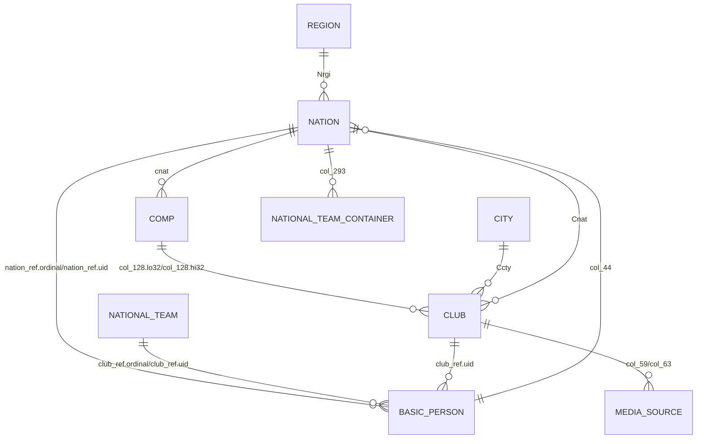

# t142 — FM24 全库外键关系图谱与引用完整性体检 (Relational FK Graph & Referential Integrity Audit)

对 **FM24 24.3.0** 实际发行数据库 (`database version 0x0df1`) 做一次**只读**的全量关系图谱挖掘：
79 张编号表 (`server_db` 59 + `client_db` 20) + `basic_people` (658,011 人) + `club_links` (9,261) + `name_table_0/1/2` (873,709 条)。

| 指标 | 值 |
|---|---:|
| 审计表数 | 84 (编号 79 + 特殊成员 5) |
| 解码行数 | 4,387,917 |
| 列清单 | 1,740 列（其中 1,337 列参与外键测试）|
| 已验证外键边 | **44**（代码印证 22 + 统计验证 22）|
| 引用对证明 (pair proof) | **6** |
| 匿名 `col_N` 破译 | **24** |
| 悬空引用行数 | **764** |
| 低特异度候选（不下结论）| 32,851 |

## 1. 判定规则（零假阳性设计）

外键只有在**无法用巧合解释**时才被确认：

1. `hit_rate ≥ 99%`（分母为去掉 `0xFF/0xFFFF/0xFFFFFFFF/0xFFFFFFFFFFFFFFFF` 哨兵后的真实值），且 `non_sentinel_rows ≥ 32`、`distinct ≥ 2`；
2. **代码印证 (code_corroborated)**：`t121` 4CC 字段名 token 命中目标类、或相邻 `(ordinal,uid)` / `(uid,dbid)` 引用对、或 C 反编译函数里对 `qword_141B5FDxx` (`DATABASE_OBJECT_REF` 全局表指针) 的引用；
3. **统计验证 (statistical)**：目标是 `uid` 域、`support_coverage ≤ 2%`（目标域只覆盖列自身值域的极小部分）、`uniform_chance ≤ 1e-3` 且 `distinct ≥ 25`；
4. 其余一律停在 `ambiguous`。**枚举守卫**：≤24 个取值的小列永远不会被提升为 `CONTINENT` / `AGREEMENT` 这类小目标表的外键。

> 关键结论：`ordinal` 域是稠密 `0..N-1`，任何计数器/枚举都能 100% “命中”，因此**序号型外键无法用统计证明**，只能靠代码印证。这也是本报告把两类分开统计的原因。

## 2. 核心实体 ER 图



`t24 NATIONAL_TEAM` 实际上是**通用 TEAM 表**（84,507 行，包含俱乐部与国家队），`CLUB` (84,259) 的 uid 是其子集；`t9 NTC` 与 `t10 NATION` 共享同一 uid 命名空间。

## 3. 已验证外键边（含匿名列）

| 源表 | 列 (4CC) | 行数 | 取值数 | 目标 | 命中率 | 特异度 cov | 悬空 | 等级 |
|---|---|---:|---:|---|---:|---:|---:|---|
| `basic_people` | `club_ref.uid` | 561,007 | 32,545 | `CLUB.uid` | 1.0000 | 0.00004 | 0 | code_corroborated |
| `basic_people` | `nation_ref.ord` | 656,818 | 227 | `NATION.ordinal` | 1.0000 | 1.00000 | 0 | code_corroborated |
| `basic_people` | `nation_ref.uid` | 656,818 | 227 | `NATION.uid` | 1.0000 | 0.00000 | 0 | code_corroborated |
| `client/10` | `Nrgi` (Nrgi) | 234 | 24 | `REGION.ordinal` | 1.0000 | 1.00000 | 0 | code_corroborated |
| `client/25` | `cnat` (Accl) | 6,769 | 231 | `NATION.ordinal` | 1.0000 | 1.00000 | 0 | code_corroborated |
| `client/3` | `Ccty` (Ccty) | 74,079 | 29,587 | `CITY.ordinal` | 1.0000 | 1.00000 | 0 | code_corroborated |
| `client/3` | `Cnat` (Cnat) | 55,928 | 227 | `NATION.ordinal` | 1.0000 | 1.00000 | 0 | code_corroborated |
| `client/7` | `col_59` | 450 | 287 | `CLUB.uid` | 1.0000 | 0.00004 | 0 | statistical |
| `client/7` | `col_63` | 450 | 287 | `CLUB.uid` | 1.0000 | 0.00004 | 0 | statistical |
| `club_links` | `club_uid` | 9,261 | 3,814 | `CLUB.ordinal` | 1.0000 | 1.00000 | 0 | code_corroborated |
| `server/10` | `col_44` | 27,178 | 27,178 | `PERSON(658k).uid` | 1.0000 | 0.00033 | 0 | statistical |
| `server/12` | `col_62.lo32` | 9,961 | 3,087 | `TEAM(t24).uid` | 0.9940 | 0.00004 | 60 | statistical |
| `server/12` | `col_70.lo32` | 9,179 | 3,021 | `TEAM(t24).uid` | 0.9935 | 0.00004 | 60 | statistical |
| `server/25` | `cnat` (Accl) | 6,769 | 231 | `NATION.ordinal` | 1.0000 | 1.00000 | 0 | code_corroborated |
| `server/26` | `stgn` (stgn) | 533 | 4 | `STAGE_NAME.ordinal` | 1.0000 | 1.00000 | 0 | code_corroborated |
| `server/3` | `Ccty` (Ccty) | 74,079 | 29,587 | `CITY.ordinal` | 1.0000 | 1.00000 | 0 | code_corroborated |
| `server/3` | `Cnat` (Cnat) | 55,928 | 227 | `NATION.ordinal` | 1.0000 | 1.00000 | 0 | code_corroborated |
| `server/3` | `col_128.lo32` | 3,373 | 100 | `COMP.uid` | 1.0000 | 0.00000 | 0 | statistical |
| `server/30` | `inju` (inju) | 72,473 | 115 | `INJURY.ordinal` | 1.0000 | 1.00000 | 0 | code_corroborated |
| `server/33` | `comp` (comp) | 1,207 | 63 | `COMP.ordinal` | 1.0000 | 1.00000 | 0 | code_corroborated |
| `server/36` | `col_34` | 11,905 | 1,772 | `COMP.uid` | 1.0000 | 0.00000 | 0 | statistical |
| `server/36` | `col_38` | 11,905 | 4,574 | `TEAM(t24).uid` | 1.0000 | 0.00004 | 0 | statistical |
| `server/38` | `comp` (comp) | 1,717 | 195 | `COMP.uid` | 1.0000 | 0.00000 | 0 | code_corroborated |
| `server/38` | `nati` (nati) | 203 | 49 | `NATION.uid` | 1.0000 | 0.00090 | 0 | code_corroborated |
| `server/42` | `col_0.lo32` | 17,721 | 16,756 | `PERSON(658k).uid` | 1.0000 | 0.00033 | 0 | statistical |
| `server/43` | `club#2.lo32` (club) | 535 | 188 | `CLUB.uid` | 1.0000 | 0.00004 | 0 | code_corroborated |
| `server/43` | `club.lo32` (club) | 535 | 122 | `CLUB.uid` | 1.0000 | 0.00074 | 0 | code_corroborated |
| `server/43` | `play.lo32` (play) | 535 | 533 | `PERSON(658k).uid` | 1.0000 | 0.00031 | 0 | statistical |
| `server/45` | `col_0` | 84,477 | 8,368 | `TEAM(t24).uid` | 0.9939 | 0.00004 | 519 | statistical |
| `server/45` | `comp.lo32` (comp) | 20,491 | 992 | `COMP.uid` | 0.9939 | 0.00000 | 125 | code_corroborated |
| `server/45` | `team.lo32` (team) | 161 | 107 | `CLUB.uid` | 1.0000 | 0.00074 | 0 | statistical |
| `server/51` | `col_0` | 59 | 30 | `CLUB.uid` | 1.0000 | 0.00004 | 0 | statistical |
| `server/60` | `col_0` | 59 | 30 | `CLUB.uid` | 1.0000 | 0.00004 | 0 | statistical |
| `server/65` | `col_0` | 1,417 | 377 | `CLUB.uid` | 1.0000 | 0.00004 | 0 | statistical |
| `server/66` | `col_0` | 753 | 343 | `CLUB.uid` | 1.0000 | 0.00004 | 0 | statistical |
| `server/66` | `nati` (nati) | 753 | 131 | `NATION.uid` | 1.0000 | 0.00000 | 0 | code_corroborated |
| `server/67` | `col_0` | 6,826 | 212 | `NATION.uid` | 1.0000 | 0.00000 | 0 | statistical |
| `server/68` | `col_0` | 138 | 51 | `LOCAL_REGION.uid` | 1.0000 | 0.00002 | 0 | statistical |
| `server/69` | `col_0` | 230 | 52 | `CITY.uid` | 1.0000 | 0.00003 | 0 | statistical |
| `server/7` | `col_59` | 450 | 287 | `CLUB.uid` | 1.0000 | 0.00004 | 0 | statistical |
| `server/7` | `col_63` | 450 | 287 | `CLUB.uid` | 1.0000 | 0.00004 | 0 | statistical |
| `server/70` | `comp` (comp) | 1,039 | 104 | `COMP.uid` | 1.0000 | 0.00000 | 0 | code_corroborated |
| `server/70` | `nati` (nati) | 840 | 99 | `NATION.uid` | 1.0000 | 0.00101 | 0 | code_corroborated |
| `server/9` | `col_293` | 1,002 | 62 | `NATION.uid` | 1.0000 | 0.00096 | 0 | statistical |

### 3.1 引用对证明（`(ordinal,uid)` / `(uid,dbid)` 布局）

| 源表 | 低半 / 高半 | 布局 | 目标 | 行数 | 联合命中 | 悬空 |
|---|---|---|---|---:|---:|---:|
| `basic_people` | `club_ref.ordinal` / `club_ref.uid` | ordinal_uid | `TEAM(t24).ordinal` | 561,007 | 1.0000 | 0 |
| `basic_people` | `nation_ref.ordinal` / `nation_ref.uid` | ordinal_uid | `NATION.ordinal` | 656,818 | 1.0000 | 0 |
| `client/7` | `col_59` / `col_63` | uid_dbid | `CLUB.uid` | 450 | 1.0000 | 0 |
| `server/3` | `col_120` / `col_124` | ordinal_uid | `STARTING_INJURY.ordinal` | 273 | 1.0000 | 0 |
| `server/3` | `col_128.lo32` / `col_128.hi32` | uid_dbid | `COMP.uid` | 3,373 | 1.0000 | 0 |
| `server/7` | `col_59` / `col_63` | uid_dbid | `CLUB.uid` | 450 | 1.0000 | 0 |

## 4. 匿名列 (`col_N`) 语义破译

共 **24** 个此前未命名的 `col_N` 列被证明是真实外键（表内偏移即列名）：

| 表 | 匿名列 | 偏移 | 目标 | 命中率 | 证据 |
|---|---|---:|---|---:|---|
| `client/7` | `col_59` | 59 | `CLUB.uid` | 1.0000 | uid_sparse:uniform_chance=1.96e-05,support_coverage=3.579e-05 |
| `client/7` | `col_59` | None | `CLUB.uid` | 1.0000 | pair:uid_dbid; joint_rate=1.0; layout:uid_dbid |
| `client/7` | `col_63` | 63 | `CLUB.uid` | 1.0000 | uid_sparse:uniform_chance=1.96e-05,support_coverage=3.579e-05 |
| `server/10` | `col_44` | 44 | `PERSON(658k).uid` | 1.0000 | uid_sparse:uniform_chance=1.53e-04,support_coverage=0.00032507 |
| `server/12` | `col_62.lo32` | 62 | `TEAM(t24).uid` | 0.9940 | uid_sparse:uniform_chance=1.97e-05,support_coverage=4.059e-05 |
| `server/12` | `col_70.lo32` | 70 | `TEAM(t24).uid` | 0.9935 | uid_sparse:uniform_chance=1.97e-05,support_coverage=4.121e-05 |
| `server/3` | `col_120` | None | `STARTING_INJURY.ordinal` | 1.0000 | pair:ordinal_uid; joint_rate=1.0; layout:ordinal_uid |
| `server/3` | `col_128.lo32` | 128 | `COMP.uid` | 1.0000 | uid_sparse:uniform_chance=1.64e-06,support_coverage=3.49e-06 |
| `server/3` | `col_128.lo32` | None | `COMP.uid` | 1.0000 | pair:uid_dbid; joint_rate=1.0; layout:uid_dbid |
| `server/36` | `col_34` | 34 | `COMP.uid` | 1.0000 | uid_sparse:uniform_chance=1.64e-06,support_coverage=3.51e-06 |
| `server/36` | `col_38` | 38 | `TEAM(t24).uid` | 1.0000 | uid_sparse:uniform_chance=1.97e-05,support_coverage=4.113e-05 |
| `server/42` | `col_0.lo32` | 0 | `PERSON(658k).uid` | 1.0000 | uid_sparse:uniform_chance=1.53e-04,support_coverage=0.00032833 |
| `server/45` | `col_0` | 0 | `TEAM(t24).uid` | 0.9939 | uid_sparse:uniform_chance=1.97e-05,support_coverage=4.224e-05 |
| `server/51` | `col_0` | 0 | `CLUB.uid` | 1.0000 | uid_sparse:uniform_chance=1.96e-05,support_coverage=3.849e-05 |
| `server/60` | `col_0` | 0 | `CLUB.uid` | 1.0000 | uid_sparse:uniform_chance=1.96e-05,support_coverage=3.849e-05 |
| `server/65` | `col_0` | 0 | `CLUB.uid` | 1.0000 | uid_sparse:uniform_chance=1.96e-05,support_coverage=4.183e-05 |
| `server/66` | `col_0` | 0 | `CLUB.uid` | 1.0000 | uid_sparse:uniform_chance=1.96e-05,support_coverage=4.103e-05 |
| `server/67` | `col_0` | 0 | `NATION.uid` | 1.0000 | uid_sparse:uniform_chance=5.84e-08,support_coverage=3.05e-06 |
| `server/68` | `col_0` | 0 | `LOCAL_REGION.uid` | 1.0000 | uid_sparse:uniform_chance=5.79e-07,support_coverage=2.481e-05 |
| `server/69` | `col_0` | 0 | `CITY.uid` | 1.0000 | uid_sparse:uniform_chance=1.31e-05,support_coverage=2.805e-05 |
| `server/7` | `col_59` | 59 | `CLUB.uid` | 1.0000 | uid_sparse:uniform_chance=1.96e-05,support_coverage=3.579e-05 |
| `server/7` | `col_59` | None | `CLUB.uid` | 1.0000 | pair:uid_dbid; joint_rate=1.0; layout:uid_dbid |
| `server/7` | `col_63` | 63 | `CLUB.uid` | 1.0000 | uid_sparse:uniform_chance=1.96e-05,support_coverage=3.579e-05 |
| `server/9` | `col_293` | 293 | `NATION.uid` | 1.0000 | uid_sparse:uniform_chance=5.84e-08,support_coverage=0.00096092 |

## 5. 悬空 / 破损引用审计

真实发行库中确实存在**少量**悬空引用（目标行不存在），逐条列出：

| 源表 | 列 | 目标 | 悬空行 | 悬空取值 | 样例 |
|---|---|---|---:|---:|---|
| `server/45` | `col_0` | `TEAM(t24).uid` | 519 | 171 | 101016,1102232,5261643,19233158 |
| `server/45` | `comp.lo32` | `COMP.uid` | 125 | 18 | 150915,413783,1768772384,2000101095 |
| `server/12` | `col_62.lo32` | `TEAM(t24).uid` | 60 | 24 | 42002934,45019985,2000099871,2000104296 |
| `server/12` | `col_70.lo32` | `TEAM(t24).uid` | 60 | 31 | 147,775156,42002934,45003367 |

总计 **764** 行悬空引用（列级 764 + 引用对 0）。

## 6. UID 命名空间重叠

`uid` 在单表内唯一，但**跨表存在系统性重叠**（同一 uid 数值在不同类中表示不同对象）：

| 类 A | 类 B | 重叠 | A 总数 | B 总数 | 样例 UID |
|---|---|---:|---:|---:|---|
| STARTING_PERSON_HISTORY | STARTING_TEAM_LEAGUE_HISTORY | 100,155 | 792,149 | 465,712 | 1,2,3,4 |
| CLUB | TEAM(t24) | 84,256 | 84,259 | 84,507 | 57,58,59,60 |
| STARTING_INJURY | STARTING_PERSON_HISTORY | 72,473 | 72,473 | 792,149 | 1,2,3,4 |
| STARTING_INJURY | STARTING_TEAM_LEAGUE_HISTORY | 67,367 | 72,473 | 465,712 | 1,2,3,4 |
| STARTING_CONFIDENCE | STARTING_INJURY | 37,283 | 37,283 | 72,473 | 1,2,3,4 |
| STARTING_CONFIDENCE | STARTING_PERSON_HISTORY | 37,283 | 37,283 | 792,149 | 1,2,3,4 |
| STARTING_CONFIDENCE | STARTING_RESERVE_TEAM | 37,214 | 37,283 | 37,214 | 1,2,3,4 |
| STARTING_INJURY | STARTING_RESERVE_TEAM | 37,214 | 72,473 | 37,214 | 1,2,3,4 |
| STARTING_PERSON_HISTORY | STARTING_RESERVE_TEAM | 37,214 | 792,149 | 37,214 | 1,2,3,4 |
| STARTING_CONFIDENCE | STARTING_TEAM_LEAGUE_HISTORY | 35,045 | 37,283 | 465,712 | 1,2,3,4 |
| STARTING_RESERVE_TEAM | STARTING_TEAM_LEAGUE_HISTORY | 34,978 | 37,214 | 465,712 | 1,2,3,4 |
| STARTING_CLUB_DEBT | STARTING_CONFIDENCE | 32,409 | 32,409 | 37,283 | 1,2,3,4 |
| STARTING_CLUB_DEBT | STARTING_INJURY | 32,409 | 32,409 | 72,473 | 1,2,3,4 |
| STARTING_CLUB_DEBT | STARTING_PERSON_HISTORY | 32,409 | 32,409 | 792,149 | 1,2,3,4 |
| STARTING_CLUB_DEBT | STARTING_RESERVE_TEAM | 32,409 | 32,409 | 37,214 | 1,2,3,4 |

- **UID 676** 同时存在于：CLUB, STADIUM, CITY, TEAM(t24)；解码出的文本字段：{'CLUB': ['Liverpool', 'Liverpool'], 'STADIUM': [], 'CITY': [], 'TEAM(t24)': []}

## 7. 身份域注册表（节选）

| 表 | 类 | 行数 | ordinal (min..max, count) | uid (min..max, count) | 不变量 |
|---|---|---:|---|---|---|
| `basic_people` | PERSON(658k) | 658,011 | 0..658010, 658,011 | 3..2002042188, 658,011 | ordinal == row index (dense 0..N-1) |
| `client/0` | AWARD | 3,545 | 0..3544, 3,545 | 102406..2000327414, 3,545 | ordinal == row index (dense 0..N-1) |
| `client/10` | NATION | 251 | 0..250, 251 | 5..82082540, 251 | ordinal == row index (dense 0..N-1) |
| `client/18` | DERBY | 1,567 | 0..1566, 1,567 | 162233..2000314625, 1,567 | ordinal == row index (dense 0..N-1) |
| `client/19` | REGION | 28 | 0..27, 28 | 1..29, 28 | ordinal == row index (dense 0..N-1) |
| `client/2` | CITY | 56,293 | 0..56292, 56,293 | 5..2000341156, 56,293 | ordinal == row index (dense 0..N-1) |
| `client/21` | STADIUM | 48,413 | 0..48412, 48,413 | 600..2000342654, 48,413 | ordinal == row index (dense 0..N-1) |
| `client/22` | STADIUM_CHANGE | 449 | 0..448, 449 | 1..449, 449 | ordinal == row index (dense 0..N-1) |
| `client/23` | STAGE_NAME | 278 | 0..277, 278 | 1..2000313236, 278 | ordinal == row index (dense 0..N-1) |
| `client/25` | COMP | 7,047 | 0..7046, 7,047 | 1..2000340046, 7,047 | ordinal == row index (dense 0..N-1) |
| `client/27` | WEATHER | 334 | 0..333, 334 | 1..2000154143, 334 | ordinal == row index (dense 0..N-1) |
| `client/3` | CLUB | 84,259 | 0..84258, 84,259 | 57..2000339171, 84,259 | ordinal == row index (dense 0..N-1) |
| `client/35` | PLAYER_TYPE | 890 | 0..889, 890 | 1..2000254886, 890 | ordinal == row index (dense 0..N-1) |
| `client/41` | CURRENCY_RECORD | 173 | 0..172, 173 | 2..87000022, 173 | ordinal == row index (dense 0..N-1) |
| `client/47` | LOCAL_REGION | 2,488 | 0..2487, 2,488 | 156580..2000300412, 2,488 | ordinal == row index (dense 0..N-1) |
| `client/5` | CONTINENT | 7 | 0..6, 7 | 1..7, 7 | ordinal == row index (dense 0..N-1) |
| `client/56` | AGREEMENT | 6 | 0..5, 6 | 1..6, 6 | ordinal == row index (dense 0..N-1) |
| `client/6` | INJURY | 115 | 0..114, 115 | 1..133, 115 | ordinal == row index (dense 0..N-1) |
| `client/7` | MEDIA_SOURCE | 208 | 0..207, 208 | 1..2000315293, 208 | ordinal == row index (dense 0..N-1) |
| `client/8` | LANGUAGE | 126 | 0..125, 126 | 1..1000004, 126 | ordinal == row index (dense 0..N-1) |
| `client/9` | NTC(t9) | 251 | 0..250, 251 | 5..82082540, 251 | ordinal == row index (dense 0..N-1) |
| `club_links` | CLUB_LINKS | 9,261 | None..None, 0 | None..None, 0 | ok |
| `name_table_0` | NAME_TABLE | 245,981 | 0..245980, 245,981 | None..None, 0 | ordinal == row index (dense 0..N-1) |
| `name_table_1` | NAME_TABLE | 542,060 | 0..542059, 542,060 | None..None, 0 | ordinal == row index (dense 0..N-1) |
| `name_table_2` | NAME_TABLE | 85,668 | 0..85667, 85,668 | None..None, 0 | ordinal == row index (dense 0..N-1) |
| `server/0` | AWARD | 3,545 | 0..3544, 3,545 | 102406..2000327414, 3,545 | ordinal == row index (dense 0..N-1) |
| `server/10` | NATION | 251 | 0..250, 251 | 5..82082540, 251 | ordinal == row index (dense 0..N-1) |
| `server/12` | STARTING_AWARD_HISTORY | 28,597 | 0..28596, 28,597 | 1..98056398, 28,597 | ordinal == row index (dense 0..N-1) |
| `server/18` | DERBY | 1,567 | 0..1566, 1,567 | 162233..2000314625, 1,567 | ordinal == row index (dense 0..N-1) |
| `server/19` | REGION | 28 | 0..27, 28 | 1..29, 28 | ordinal == row index (dense 0..N-1) |
| `server/2` | CITY | 56,293 | 0..56292, 56,293 | 5..2000341156, 56,293 | ordinal == row index (dense 0..N-1) |
| `server/21` | STADIUM | 48,413 | 0..48412, 48,413 | 600..2000342654, 48,413 | ordinal == row index (dense 0..N-1) |
| `server/22` | STADIUM_CHANGE | 449 | 0..448, 449 | 1..449, 449 | ordinal == row index (dense 0..N-1) |
| `server/23` | STAGE_NAME | 278 | 0..277, 278 | 1..2000313236, 278 | ordinal == row index (dense 0..N-1) |
| `server/24` | TEAM(t24) | 84,507 | 0..84506, 84,507 | 5..2000339171, 84,507 | ordinal == row index (dense 0..N-1) |
| `server/25` | COMP | 7,047 | 0..7046, 7,047 | 1..2000340046, 7,047 | ordinal == row index (dense 0..N-1) |
| `server/26` | COMP_HISTORY_RECORD | 90,128 | 0..90127, 90,128 | 1..98081958, 90,128 | ordinal == row index (dense 0..N-1) |
| `server/27` | WEATHER | 334 | 0..333, 334 | 1..2000154143, 334 | ordinal == row index (dense 0..N-1) |
| `server/29` | STARTING_LOAN | 13,278 | 0..13277, 13,278 | 1..13278, 13,278 | ordinal == row index (dense 0..N-1) |
| `server/3` | CLUB | 84,259 | 0..84258, 84,259 | 57..2000339171, 84,259 | ordinal == row index (dense 0..N-1) |
| `server/30` | STARTING_INJURY | 72,473 | 0..72472, 72,473 | 1..72473, 72,473 | ordinal == row index (dense 0..N-1) |
| `server/31` | STARTING_CONFIDENCE | 37,283 | 0..37282, 37,283 | 1..37283, 37,283 | ordinal == row index (dense 0..N-1) |
| `server/32` | STARTING_FUTURE_TRANSFER | 315 | 0..314, 315 | 1..315, 315 | ordinal == row index (dense 0..N-1) |
| `server/33` | STARTING_CLUB_DEBT | 32,409 | 0..32408, 32,409 | 1..32409, 32,409 | ordinal == row index (dense 0..N-1) |
| `server/34` | STARTING_TEAM_CUP_HISTORY | 7,115 | 0..7114, 7,115 | 103..98041869, 7,115 | ordinal == row index (dense 0..N-1) |
| `server/35` | PLAYER_TYPE | 890 | 0..889, 890 | 1..2000254886, 890 | ordinal == row index (dense 0..N-1) |
| `server/36` | STARTING_MANAGER_HOF_RECORD | 6,535 | 0..6534, 6,535 | 4294967295..4294967295, 1 | ordinal == row index (dense 0..N-1); duplicate uid values: 6 |
| `server/37` | STARTING_TEAM_LEAGUE_HISTORY | 465,712 | 0..465711, 465,712 | 1..98206088, 465,712 | ordinal == row index (dense 0..N-1) |
| `server/38` | STARTING_BAN | 5,241 | 0..5240, 5,241 | 1..5241, 5,241 | ordinal == row index (dense 0..N-1) |
| `server/39` | STARTING_AVG_POINTS | 117 | 0..116, 117 | 1..117, 117 | ordinal == row index (dense 0..N-1) |
| `server/41` | CURRENCY_RECORD | 173 | 0..172, 173 | 2..87000022, 173 | ordinal == row index (dense 0..N-1) |
| `server/42` | STARTING_RETIREMENT | 17,721 | 0..17720, 17,721 | 1..17721, 17,721 | ordinal == row index (dense 0..N-1) |
| `server/43` | STARTING_MONTHLY_INSTALLMENT | 535 | 0..534, 535 | 1..535, 535 | ordinal == row index (dense 0..N-1) |
| `server/45` | STARTING_RECORD | 84,477 | 0..84476, 84,477 | 1..89975, 84,477 | ordinal == row index (dense 0..N-1) |
| `server/46` | STARTING_DRAFT_TRANSFER | 7 | 0..6, 7 | 1..7, 7 | ordinal == row index (dense 0..N-1) |
| `server/47` | LOCAL_REGION | 2,488 | 0..2487, 2,488 | 156580..2000300412, 2,488 | ordinal == row index (dense 0..N-1) |
| `server/48` | STARTING_RECORD | 5,210 | 0..5209, 5,210 | 1..6303, 5,210 | ordinal == row index (dense 0..N-1) |
| `server/49` | STARTING_PERSON_HISTORY | 792,149 | 0..792148, 792,149 | 1..792149, 792,149 | ordinal == row index (dense 0..N-1) |
| `server/5` | CONTINENT | 7 | 0..6, 7 | 1..7, 7 | ordinal == row index (dense 0..N-1) |
| `server/50` | STARTING_MLS_TRADED_SLOT | 45 | 0..44, 45 | 1..45, 45 | ordinal == row index (dense 0..N-1) |
| `server/51` | STARTING_MLS_GENERAL_ALLOCATION_MONEY | 59 | 0..58, 59 | 1..59, 59 | ordinal == row index (dense 0..N-1) |
| `server/52` | STARTING_PLAYER_HAPPINESS | 0 | None..None, 0 | None..None, 0 | ok |
| `server/56` | AGREEMENT | 6 | 0..5, 6 | 1..6, 6 | ordinal == row index (dense 0..N-1) |
| `server/57` | FIXTURE_NAME | 0 | None..None, 0 | None..None, 0 | ok |
| `server/58` | STARTING_WEEKLY_WAGE_CONTRIBUTION | 8 | 0..7, 8 | 1..8, 8 | ordinal == row index (dense 0..N-1) |
| `server/59` | STARTING_MEDIA_EXPECTATIONS | 9,079 | 0..9078, 9,079 | 1..9079, 9,079 | ordinal == row index (dense 0..N-1) |
| `server/6` | INJURY | 115 | 0..114, 115 | 1..133, 115 | ordinal == row index (dense 0..N-1) |
| `server/60` | STARTING_MLS_TARGETED_ALLOCATION_MONEY | 59 | 0..58, 59 | 1..59, 59 | ordinal == row index (dense 0..N-1) |
| `server/61` | STARTING_ITALIAN_SERIE_A_CLUB_THAT_FREED_UP_NON_EU_SLOT | 16 | 0..15, 16 | 1..16, 16 | ordinal == row index (dense 0..N-1) |
| `server/62` | STARTING_RESERVE_TEAM | 37,214 | 0..37213, 37,214 | 1..37214, 37,214 | ordinal == row index (dense 0..N-1) |
| `server/63` | STARTING_ITALIAN_SERIE_A_CLUB_NON_EU_SLOTS_NUMBER | 2 | 0..1, 2 | 1..2, 2 | ordinal == row index (dense 0..N-1) |
| `server/64` | STARTING_CLUB_STAFF_JOB_STATUS | 6,946 | 0..6945, 6,946 | 1..6946, 6,946 | ordinal == row index (dense 0..N-1) |
| `server/65` | STARTING_NEWGEN_PARAMETER | 1,417 | 0..1416, 1,417 | 1..1417, 1,417 | ordinal == row index (dense 0..N-1) |
| `server/66` | STARTING_CLUB_TRANSFER_PREFERENCE | 753 | 0..752, 753 | 1..753, 753 | ordinal == row index (dense 0..N-1) |
| `server/67` | STARTING_NEWGEN_PARAMETER | 6,826 | 0..6825, 6,826 | 1..6826, 6,826 | ordinal == row index (dense 0..N-1) |
| `server/68` | STARTING_NEWGEN_PARAMETER | 138 | 0..137, 138 | 1..138, 138 | ordinal == row index (dense 0..N-1) |
| `server/69` | STARTING_NEWGEN_PARAMETER | 230 | 0..229, 230 | 1..230, 230 | ordinal == row index (dense 0..N-1) |
| `server/7` | MEDIA_SOURCE | 208 | 0..207, 208 | 1..2000315293, 208 | ordinal == row index (dense 0..N-1) |
| `server/70` | STARTING_VISION_OBJECTIVE | 10,075 | 0..10074, 10,075 | 1..10075, 10,075 | ordinal == row index (dense 0..N-1) |
| `server/71` | STARTING_PAST_TRANSFER | 616,665 | 0..616664, 616,665 | 17786..4294967295, 610,260 | ordinal == row index (dense 0..N-1); duplicate uid values: 6 |
| `server/72` | STARTING_PAST_TRADE | 138 | 0..137, 138 | 1..138, 138 | ordinal == row index (dense 0..N-1) |
| `server/73` | STARTING_ITALIAN_SERIE_A_NON_EU_PLAYER_SIGNED_FOR_RESTRICTED_SLOT | 1 | 0..0, 1 | 1..1, 1 | ordinal == row index (dense 0..N-1) |
| `server/8` | LANGUAGE | 126 | 0..125, 126 | 1..1000004, 126 | ordinal == row index (dense 0..N-1) |
| `server/9` | NTC(t9) | 251 | 0..250, 251 | 5..82082540, 251 | ordinal == row index (dense 0..N-1) |

## 8. 复现

```bat
py -V:3.12 -B scripts/t142_fk_graph_audit.py            # 全流程（解码→域→图谱→报告）
py -V:3.12 -B scripts/t142_fk_graph_audit.py --selftest # 自检
```

中间产物：`scratch/t142/out/cache/`（列存储）、`stage1_columns.json`、`stage2_domains.json`、`stage3_edges.json`、`fk_graph_master.json`。

