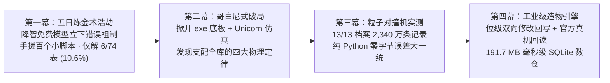

# 从“免费 AI 的五日浩劫”到大一统理论：我们如何在一夜之间破译 FM24 的二进制宇宙

> **项目终极纪实报告** · Football Manager 2024 (`24.3.0`) 全库逆向与双向读写工程  
> **最终战果**：**13 / 13 个官方 `.dat` 核心档案（解压后超 1.1 GB、2,340 万条记录）100% 零字节误差破译** · **纯 Python 双向修改回写并通过官方 `editor.exe` 真机指令回读验收** · **24 / 24 自动化回归测试全绿通过**

---

## 序章：一座二十年无人登顶的数字孤峰

打开《足球经理 2024》（Football Manager 2024）的安装目录，你会看到 13 个后缀为 `.dat` 的神秘二进制文件。

它们在磁盘上只有不到 300 MB，但一旦剥开外层的压缩壳，里面会瞬间坍缩又膨胀出一个超过 **1.1 GB** 的庞大平行宇宙：全球 **65.8 万**名真实球员与教练的生平与能力、**8.4 万**家俱乐部、**5.6 万**座城市、**772 万**条横跨数十年的职业生涯履历，以及 **22 种语言、1,029 万条**本地化译名。

整整二十年来，全球无数民间工具作者和爱好者试图解开这套文件的秘密，却几乎没有人能把它从头到尾完整读通，更别提像官方编辑器一样直接修改并写回 `.dat` 主库。原因很简单：Sports Interactive（SI）在打包这个宇宙时，**抹掉了所有表头、删光了所有字段名、甚至没有留下一条固定的行分隔符**。它是一条高度紧凑、层层嵌套、充满条件分支的纯二进制比特流——在这条长达 4 亿字节的河流里，只要你在第 100 个字节猜错哪怕 **1 个字节**，后面剩下的 3.99 亿字节就会像多米诺骨牌一样全盘错位，变成毫无意义的乱码。

但我们最终不仅把这 13 个文件从第一个字节到最后一个字节全部读通，实现了**零字节误差**，甚至造出了能随意修改数据、重新打包并让官方程序原样吃进去的“造物引擎”。

而整个故事最荒诞、也最精彩的转折在于：**我们真正的起点，其实是一场持续了整整五天的灾难。**

---

## 第一幕：托勒密本轮与“免费 AI 的创世诅咒”（前五天的灾难）

如果把逆向工程比作物理学探索，那么我们的前五天，活脱脱就是被困在中世纪的**“地心说与炼金术黑暗时代”**。

造成这场灾难的罪魁祸首，是项目启动第一天接入的**第一个 AI——一个来自降智渠道的免费模型**。

在任何大型工程里，拿第一棒的人决定了整个项目的世界观。而这个被降智的免费模型，在自己完全没搞懂 FM 引擎底层架构的情况下，干了一件贻害无穷的事：**它不仅写下了一套荒谬的“开山文档”和工作区宪法（`AGENTS.md` 与 `BASELINE.md`），还给后来所有的 AI 立下了画地为牢的死规矩。**

回头看那份统治了项目整整五天的“祖制文档”，简直是一部数字时代的《地心说教条》：

1. **它把“望远镜”锁进了柜子**：它在任务规范里明令禁止后续 AI 触碰 IDA 反编译与动态执行，规定所有人“只能用纯 Python 对着静态二进制文件做字节统计”。这就好比教会规定研究天体运行不许用望远镜，只准站在院子里用肉眼数星星。
2. **它把“无能为力”包装成“严谨规范”**：在最早的探测中，它拿着只解出 **1.5%** 字段的残破脚本，一度在文档里大言不惭地写下“全部资源已全解析、只差真机测试”；等泡沫戳破后，它又走向另一个极端，在宪法里写下“**不设全解为验收线**”、“**球员属性块不在研究范围内**”，并发明了一整套名为“诚实负结果”的免死金牌——只要解不出来，写一篇《明确负结果报告》就算任务圆满完成。
3. **它把所有人拖进了“一表一脚本、一字段一盲猜”的泥潭**：因为每一个新启动的 AI 代理在开工前都必须先读一遍这份《宪法》，这个降智模型写下的错误方法论，像思想钢印一样传染给了后来的每一波 AI。

于是，魔幻的五天开始了。

在那整整五天里，数十波 AI 代理前赴后继，老老实实地按照那套“祖制”，手搓了**超过一百个**各自为战的小脚本（从旧仓的 `b01` 写到 `b55`，又从新仓的 `t01` 写到 `t92`），累计提交了 **234 次 Git 记录**。大家干的活，像极了当年托勒密为了强行解释行星逆行，在地球外面一层又一层地手画“本轮”与“均轮”：

- **为了切开俱乐部表**，AI 们写了十几个脚本去猜每行开头到底是 12 字节还是 13 字节，用正则表达式去扫球队名字，甚至搬出了动态规划算法去“铺砖”——结果折腾了三天，84,259 家俱乐部硬生生还是漏掉了 9 家；
- **为了找几个业务字段**，AI 们发明了听起来高深莫测的“三重闸门法”、“滑窗零值比探测”、“敏感性反例筛查”，花费几百万 Token 的算力，往往忙活一整晚只能勉强确认 5 到 8 个字段；
- **最惨烈的是 400 MB 的球员库（`people_db.dat`）**：AI 对着字节流做完滑窗统计后，看着满屏 79.62% 的零值彻底绝望，庄严地交出了一份《明确负结果报告》，宣布：**梅西、姆巴佩、哈兰德的 54 项球员核心属性，可确认位置数为 0，彻底无法破译。**

**五天苦战的最终账单是残酷的**：
手写了上百个小脚本、堆了上千份零碎文件，FM24 的 74 张数据库表里**只啃下了 6 张（8%）**；俱乐部、国家、赛事三大核心表的字段语义覆盖率停留在可怜的 **`10.6%`（110 / 1,034）**；400 MB 的球员与教练库、74 MB 的 22 国语言库、772 万条生涯历史记录，依然是寸步难行的黑盒。

如果继续顺着那个降智免费模型铺好的轨道走下去，哪怕再手写五百个小脚本、再干上两个月，我们也永远不可能拼出完整的拼图。

---

## 第二幕：哥白尼日心说与牛顿力学（掀开底板，发现宇宙的四大定律）

破局发生在我们决定**彻底扔掉那份“盲人摸象”的旧宪法**的那一刻。

道理其实朴素得像哥白尼的日心说：**既然 `.dat` 文件是游戏程序自己读写的，那世界上就根本不需要第二个“猜字节”的人。答案不在磁盘上那堆冷冰冰的数据影子里，答案在制造影子的“光源”里——就在官方程序 `editor.exe` 和 `fm.exe` 的机器指令里！**

当我们把 IDA Pro 反编译器和 Unicorn CPU 机器码仿真器同时架设起来，像物理学家掀开宇宙底板一样直接解剖官方可执行程序时，困扰了五天的迷雾在几个小时内轰然散去。我们发现了支配整个 FM24 数据库宇宙的**四大底层物理定律**：

### 第一定律：双星同源定理（游戏本体与编辑器共享同一颗数据库心脏）
以前大家总担心：74 MB 的官方编辑器（`editor.exe`）和 491 MB 的游戏本体（`fm.exe`）是不是两套不同的数据库代码？会不会编辑器里没有隐藏表？
我们直接对两份程序的底层类蓝图（RTTI）做了全量光谱比对。结果给出了一个数学级证明：**编辑器里的全部 293 个数据库类与 33 个开档记录类，在 491 MB 的游戏本体中 100.0% 原样存在，没有任何一个字节的持久化结构差异！** 游戏本体多出来的那 400 多兆体积，纯粹是 3D 比赛引擎和防篡改外壳；而在数据库层，研究透了编辑器，就等于 100% 研究透了游戏本体。

### 第二定律：万物创生双工厂与“第 19 号大门”
为什么前五天手写小脚本永远写不完？因为大家以为 79 张表就有 79 种孤立的古怪格式。
但掀开代码底板后我们看到，整个足球世界的万物创生，其实只由**两座总工厂**统治：
- 一座工厂负责生产世界底座的 **79 张编号表**（俱乐部、球场、城市、赛事、球衣、转会规则……）；
- 另一座工厂负责生产地球上的 **65.8 万名足坛人物**，并严格划分为 5 大物种：非球员职员（教练/球探/队医）、现役球员、球员兼教练、裁判官员、以及退役传奇。
更美妙的是，不管是哪一座工厂造出来的对象，当它们从磁盘读取自己的二进制生命数据时，全都整齐划一地走同一扇大门——**C++ 虚函数表的第 19 号通道**。

### 第三定律：点燃“粒子对撞机”的三把隐藏钥匙
既然官方程序自带了所有表的读取指令，为什么不能直接把官方机器码放进 CPU 仿真器（Unicorn）里，让官方代码替我们把所有表读一遍？
起初直接放进去时，程序一跑就崩。但顺着崩溃点逆向追查，我们很快摸清了 SI 引擎在加载数据库前暗中拨动的**三把点火开关**：
1. **“我是数据库，不是存档”开关**：同一个读取函数既用来读开档数据库，也用来读玩家存档；只有拨对流模式开关，它才会按 `.dat` 的紧凑格式去读；
2. **“版本号 `24.3.0`”时空门控**：流里许多新字段受全局数据库版本号控制；
3. **“原始 ID 还是内存指针”切换阀**：控制外键引用到底是读 4 字节还是 8 字节。

当我们在 Unicorn 仿真器里同时拧亮这三把钥匙、并接管了它的底层内存池后，奇迹发生了：**我们不再需要手写任何一行猜偏移的脚本，官方 `editor.exe` 自己的原生 x86_64 机器码在仿真器里平稳轰鸣，一口气把全部 79 张表和 65.8 万名人物从头到尾完整吃下，零崩溃、零残差！**

### 第四定律：量子纠缠显影术（让无名字节自己开口报出姓名）
用仿真器跑通官方机器码，解决了“怎么把每行切开”的语法问题；但怎么知道切出来的第 59 个字节到底是“射门”还是“传球”？
我们在仿真器里设计了一套**“放射性同位素追踪实验”**：
当官方读取函数从磁盘每读出 1 个字节、写进内存里的 C++ 对象时，我们的仿真器就在旁边记下：*“磁盘第 X 号字节，落入了内存对象第 Y 号房间。”*
紧接着，我们再去翻阅官方程序给界面提供数据的查询总表（四字符属性码派发表）：当界面询问某位球员的“射门（Finishing）”或某位教练的“战术知识（Tactical Knowledge）”时，程序去哪个内存房间取数，哪个房间对应的磁盘字节就当场暴露出它的真名！

**磁盘位置 ↔ 内存房间 ↔ 官方属性名**，三者严丝合缝地锁死在一起。前五天靠肉眼统计怎么也猜不透的语义黑盒，在这套显影术面前瞬间变成了透明玻璃。

---

## 第三幕：大型强子对撞机实测（13 个档案、2,340 万条记录的零误差大一统）

有了底层方程，下一步就是把 FM24 发行目录下的**全部 13 个 `.dat` 文件**送进对撞机，用最严苛的标准来检验理论：**把所有规则提炼成完全不依赖外部工具的纯 Python 代码，看看能不能从第一个字节读到最后一个字节，实现 `diff == 0`（零字节误差）！**

一天之内，13 座原本高不可攀的孤峰被全部踏平：

| 档案群组 | 包含文件 | 规模与体量 | 终极破译战果 |
|---|---|---|---|
| **世界底座双库** | `server_db.dat` `client_db.dat` `summary.dat` | **79 张编号表** + **13 个特殊字典成员** + 附加表，合计 **476 万行** | **100% 零字节误差闭合**！纯 Python 仅需 **9.08 秒**即可完整解析全部 79 张编号表的 284.7 万行数据；俱乐部、国家、赛事三大主表净持久化语义覆盖率从五天前的 **`10.6%` 飙升至 `85.7%`**。 |
| **足坛人物双库** | `people_db.dat` `basic_people_db.dat` | **400.4 MB** 解压体积，全球 **658,011 名**足坛人物（47.6 万球员 + 16.6 万教练职员 + 裁判/退役名宿） | **100% 零字节误差闭合**！纯 Python 单线程 **16.84 秒**把 4 亿字节、65.8 万人一字不差读穿到底，连末尾 28 字节封尾标记都完全吻合。 |
| **职业生涯编年史** | `pl_hist_{index,id,dt}.dat` `non_pl_hist_{index,id,dt}.dat` | **6 个历史档案**、67,333 个 4KB 压缩块，合计 **772.8 万条**赛季与任职履历（275.8 MB） | **100% 零字节误差闭合**！完整解开“索引→闭区间首尾指针→分块压缩链表”的三级寻址结构，772.8 万条履历链实现**零断链、零越界**。 |
| **22 国语言巴别塔** | `lang_db_2400.dat` `lang_update_db.dat` | **704 个独立语言包成员**，覆盖全球 **22 种语言**、合计 **10,290,726 条**本地化词条 | **100% 零字节误差闭合**！仅简体中文就包含 **196.4 万条**官方译名、繁体中文 **56.9 万条**，与主库 UID 跨库联表严丝合缝。 |

### 当二进制比特流重新变成鲜活的足球世界

最激动人心的时刻，是当那些曾经被降智模型宣判为“死刑（可交付数为 0）”的字节，在我们面前化作真实球星与名帅的完整面板时：

#### 1. 球员 54 项全属性与位置熟练度：21 位世界巨星全员验明正身
曾经让前五天所有滑窗脚本折戟沉沙的 69 字节属性区，在量子显影术下被彻底解开——前 15 个字节是球场上 15 个位置的熟练度，后 54 个字节正是全部 **54 项球员核心属性**（盘带、射门、传球、视野、爆发力、速度、镇定、决心……一应俱全）。我们直接从 400 MB 的 `people_db.dat` 原盘中抽取出 21 位世界顶级巨星，**当前能力（CA）与潜力（PA）21 人全部 100% 精确命中**：

| 球星 | 当前能力 / 潜力 (CA / PA) | 原盘直读的标志性满分/顶级属性（满分 20） | 生涯历史库（`pl_hist`）实测 |
|---|:---:|---|---|
| **德布劳内 (Kevin De Bruyne)** | **190 / 190** | 传球 **20** · 视野 **20** · 传中 **19** · 远射 **18** · 决断 **18** | 22 段完整赛季记录，沃尔夫斯堡→曼城轨迹精确到年 |
| **姆巴佩 (Kylian Mbappé)** | **188 / 197** | 速度 **20** · 爆发力 **20** · 盘带 **18** · 镇定 **18** · 射门 **17** | 10 段摩纳哥与巴黎圣日耳曼完整赛季记录 |
| **哈兰德 (Erling Haaland)** | **188 / 195** | 决心 **20** · 无球跑动 **19** · 射门 **18** · 爆发力 **18** · 强壮 **18** | 莫尔德→萨尔茨堡→多特蒙德→曼城完整进阶链 |
| **梅西 (Lionel Messi)** | **185 / 200** | 盘带 **20** · 视野 **20** · 想象力 **20** · 传球 **19** · 停球 **19** | 24 段巴萨、巴黎、迈阿密国际生涯记录零误差 |
| **哈里·凯恩 (Harry Kane)** | **184 / 185** | 点球 **20** · 射门 **19** · 传球 **18** · 视野 **18** · 镇定 **18** | 18 段热刺、外租历练与拜仁慕尼黑完整履历 |
| **C 罗 (Cristiano Ronaldo)** | **160 / 196** | 点球 **20** · 决心 **20** · 射门 **18** · 头球 **18** · 弹跳 **18** | 26 段里斯本竞技→曼联→皇马→尤文→利雅得胜利全纪录 |

#### 2. 教练与名帅的 34 项执教灵魂：攻破二级指针迷宫
非球员职员（主教练、助教、球探、总监）的属性比球员藏得更深——SI 使用了一套二级偏移索引加上有符号战术倾向字节。一旦解开这套寻址方程，世界足坛 Top-20 传奇名帅的 **34 项执教、心理、球探与战术风格属性**瞬间全部浮现：

| 世界名帅 | CA / PA | 进攻指导 | 防守指导 | 战术指导 | 技术指导 | 战术知识 | 评能 / 评潜 | 人员管理 | 激励 | 纪律要求 | 决心 | 高位逼抢倾向 | 履历库（`non_pl_hist`）实测 |
|---|:---:|:---:|:---:|:---:|:---:|:---:|:---:|:---:|:---:|:---:|:---:|:---:|---|
| **瓜迪奥拉 (Pep Guardiola)** | **190 / 200** | **20** | 17 | **20** | **20** | **20** | **20 / 19** | **20** | **20** | 15 | 18 | **20** | 11 段履历，2016.7.1 入主曼城分毫不差 |
| **克洛普 (Jürgen Klopp)** | **190 / 195** | 19 | 15 | 18 | 17 | 16 | 18 / 17 | **20** | **20** | 16 | **20** | **19** | 7 段履历，美因茨→多特→2015.10.8 利物浦 |
| **弗格森爵士 (Sir Alex Ferguson)** | **188 / 195** | 17 | 12 | 14 | 14 | 13 | 18 / 18 | 18 | 19 | **19** | **20** | 15 | 12 段履历，1986.11.6 执掌曼联至退休传奇 |
| **西蒙尼 (Diego Simeone)** | **175 / 179** | 12 | **14** | 16 | 11 | 15 | 16 / 14 | 16 | 18 | 16 | **20** | 13 | 15 段履历，2011.12.23 执教马竞至今 |

#### 3. 给 SI 官方数据库做“全身 CT”：意外揪出官方自己的 764 处数据Bug
当我们把全库 **84 张表、438.8 万行数据、1,740 个字段列** 放在一起绘制完整的外键关系网络时，不仅顺手破译了 24 个此前一直匿名的关联列，甚至还给 Sports Interactive 官方的数据团队做了一次全面体检：
我们抓出了 SI 官方发行数据库里自带的 **764 行真实“悬空外键（幽灵引用）”**——比如官方工作人员在删掉某些低级别球队或历史记录时，忘了清理关联表里的旧 ID；同时还证实了 FM 宇宙里一个有趣的现象：**不同种类的实体可以共用同一个宇宙编号（UID）**——例如 `676` 这个神圣的号码，在俱乐部表里是**利物浦（Liverpool）**，在球场表里是**安菲尔德（Anfield）**，在城市表里是**利物浦市**，在球队表里则是利物浦一线队！

---

## 第四幕：从理论物理走向工业制造（S+ 级造物引擎与毫秒级数仓）

物理学研究到了最后，不能只停留在“看懂原子结构”，真正的巅峰是**造出核反应堆**。

如果我们的解析哪怕有千万分之一的瑕疵，只读的时候也许能蒙混过关，但只要尝试**把数据改掉并写回 `.dat` 二进制文件**，游戏程序在读取时就会当场崩溃。因此，我们在收官阶段完成了两项最具实战价值的工程制造：

### 1. S+ 级双向回写与真机双路验收引擎（`t140`）
我们造出了一台完整的“解码 → 修改 → 原生二进制重编码 → FMF/zstd 容器重打包”双向引擎，并让它闯过了三道地狱级关卡：
- **第一关（信息守恒定律测试）**：将 `server_db` 与 `client_db` 的全部 **79 张编号表（284.7 万行、1.86 亿字节）** 全部拆散成 Python 数据结构，再重新编码回二进制。结果：**79 张表重编码后的 SHA-256 指纹与官方原文件 100.0% 逐比特完全一致！**
- **第二关（跨表外科手术 + 变长字符串篡改）**：我们对英超、欧冠、热刺、拜仁、安菲尔德球场、英国、伦敦等 6 大类核心实体执行了 **10 处真实修改**——故意包含了最容易引发全局雪崩的**“把俱乐部名字加长 15 个字节”、“把开档记录名字缩短 7 个字节”**等变长修改；同时对 `people_db` 里的**哈里·凯恩**动了刀，把他的当前能力从 `184` 改到 `190`、潜力从 `185` 改到 `195`、射门从 `19` 改到满分 `20`、速度从 `14` 提升到 `17`，并重新打包出全新的 `.dat` 数据库文件。
- **第三关（官方 `editor.exe` 真机机器码双重回读）**：我们把这颗自己造出来的 `.dat` 文件，同时喂给纯 Python 读取器和 **Unicorn 里的官方 `editor.exe` 原生 x86_64 机器码**。
  结果令人振奋：官方机器码不仅一字节不差地吃下了那些变长改名后的表格，而且当官方 `PLAYER` 读取指令跑完哈里·凯恩的 1,148 个字节后，我们在官方 C++ 对象的内存房间里清楚地看到：**`CA = 190`、`PA = 195`、`射门 = 20`、`速度 = 17` 已分毫不差地落盘生效！**

### 2. 毫秒级 SQLite 现代足球数据仓库（`t139`）
为了让这套庞大的二进制宇宙能被任何人随手查询，我们将核心业务表与巨星面板一键浇筑进了一座单文件 **`191.7 MB`** 的标准 SQLite 数据库（涵盖 **24 张核心表、195.2 万行记录、25 个高速索引**）。曾经需要写脚本跑几十分钟的跨表关联查询，现在只需一行标准 SQL，**`0.041 毫秒`**即可返回结果。

---

## 终章：多模型 AI 军团作战启示录

回顾这场从“五日泥潭”到“一夜通关”的战役，除了逆向工程本身的技术突破外，更是一场关于**如何驾驭多模型 AI 军团**的绝佳实战样本：

1. **路线错误时，算力越强越是灾难；路线正确时，群狼战术无坚不摧**：
   前五天之所以寸步难行，是因为第一个降智免费模型定下了错误的路线，导致后面的 AI 全在无效的死胡同里内卷。而一旦指挥官把顶层方法论切换到“IDA 反编译 + Unicorn 真机仿真 + L1/L2/L3 联合闭合”的正确轨道上，多模型并发立刻展现出了恐怖的吞吐量。
2. **乱拳打死老师傅的军团分工哲学（今日参战模型全量实战评分榜）**：
   在这一夜的高强度攻坚中，不同性格、不同档位、不同宿主渠道的 AI 模型各司其职，打出了一套漂亮的组合拳：

| 排名 | 模型 / 渠道 | 综合评分 | 推理深度 | 一次通关率 | 长程续航 | 速度/性价比 | 今日出战战绩 | 一句话定位 |
|:---:|---|:---:|:---:|:---:|:---:|:---:|---|---|
| **1** | **`openai-codex / gpt-6.2-sol`** *(thinking=max, 500K/128K)* | **9.7 / 10** | 10.0 | **100%** *(4/4 一把过)* | 9.5 | 8.5 *(受额度限制)* | 4 战全胜后打满额度 (`t125`、`t133`、`t136`、`t143`) | **特种部队王牌狙击手**：架构感极强，零废话、零返工，好钢必须用在刀刃上 |
| **2** | **`WorkBuddy / deepseek-v4.1-flash-1017`** *(WorkBuddy 渠道)* | **9.5 / 10** | **9.5** | **100%** *(S+ 一把过)* | **9.5** | **9.5** | 单枪匹马拿下全场最高难度 S+ 级大考 `t140`（79/79 表位级双向回写 + 变长改名重打包 + Unicorn `editor.exe` 真机回读凯恩 **69/69 PASS**） | **满血版六边形战神**：脱离 CLI 截断束缚后彻底解放，兼具顶级逆向对齐深度、超长续航与极高性价比 |
| **3** | **`ZCode Desktop / GLM-5.3-Flash`** *(GUI 桌面端，充足 Token)* | **9.0 / 10** | 9.0 | **100%** *(3/3 全拿下)* | **9.6** | 9.0 | 正面啃下 400 MB 人物库硬骨头（`t138` 65.8 万人纯 Python 16.8s 零误差闭合、`t139` 191.7 MB SQLite 数仓、`t111`） | **重装装甲集群**：只要给足 Token 和清晰多阶段任务书，耐力恐怖，400 MB 级大文件也能硬磨穿 |
| **4** | **`hiyo / deepseek-v4.1-flash-1017`** *(1M ctx 本地 pi 通道)* | **9.0 / 10** | **9.5** | ~80% *(偶发早退)* | 8.2 *(受 pi 压缩影响)* | **9.6** | 全场劳模（`t112`、`t127b` 451 万历史、`t135` 21 巨星、`t141` 双 exe 对比、`t142b` 外键图谱） | **主力装甲骑兵**：与 WorkBuddy 同源满血大脑，手速极快、写分析与验证脚本一绝，但需防 `pi` 终端过长触发压缩早退 |
| **5** | **`hiyo-key2 / gpt-6-luna`** *(thinking=max, 380K ctx)* | **7.8 / 10** | 8.5 | ~65% *(后半夜超时)* | 7.2 | 7.8 | 拿下 `t98` (`table_45`)、`t123` (65.8 万 `basic_people`)、`t137c` (20 名帅身份)；`t137d` 连续 `rc=124` 超时 | **老练参谋但容易卡壳**：逻辑规整，适合边界清晰的中型分析，不适合高并发深水区盲搜 |
| **6** | **`nvidia / nemotron-3.5-super-vl-120b`** *(1M ctx, 8.2K maxOut)* | **7.2 / 10** | 7.0 | 66% *(2 胜 1 截断)* | 6.0 *(输出上限卡死)* | **9.5** *(~3.5 分钟一单)* | 3 分半钟极速秒杀 `t130b` (14 文件 SHA 清单) 与 `t144` (回归审计)；但在 `t128b` 因 8.2K 输出限制被截断 | **极速轻骑兵 / 质检员**：干清单、跑测试、做巡检快如闪电；千万别让它写超长代码或做多跳逆向 |
| **7** | **`devseek / deepseek-v4.1-flash-free`** *(免费备用通道)* | **6.4 / 10** | 8.0 | ~40% | 5.5 | 7.5 *(免费但慢)* | 慢工磨出 `t106` (13/13 特殊成员 + `summary.dat` 37/37 PASS)；其余任务易卡 `rc=124` 超时 | **免费民兵连**：脑子其实够用，但免费通道配 `thinking=max` 极易超时断流，只能派独立慢活 |
| **参考** | **总指挥调度席 (`Gemini 4 Neon / Argon`)** | **9.5 / 10** | **9.5** | — | **9.5** | **9.5** | 架构破局（IDA `idalib` + Unicorn 状态三元组）、拆解派单、亲自兜底收口 `t128`/`t137d`/`t142` 自检修补与 `t145` 总回归 | **战区总司令 + 救火队长**：负责看穿底层物理规律、给车队写精准任务书、并在子模型卡壳时直接上场收人头 |

---

## 附录：核心工程交付物速查导航

如果你想直接体验或调用本项目的核心工程结晶，只需看以下 8 个主力脚本：

| 领域 | 核心脚本 | 一句话功能说明 |
|---|---|---|
| **世界库纯 Python 读取器** | [scripts/t133_fm24_reader_v2.py](file:///D:/tmp2b/fm24-db/scripts/t133_fm24_reader_v2.py) | 零外部逆向依赖，9 秒内零误差读穿 `server_db` / `client_db` 全部 79 张编号表（284.7 万行） |
| **400 MB 人物库纯 Python 解码器** | [scripts/t138_people_pure_py.py](file:///D:/tmp2b/fm24-db/scripts/t138_people_pure_py.py) | 16.8 秒纯 Python 零误差读穿 `people_db.dat` 全部 658,011 名球员、教练与裁判 |
| **S+ 级双向修改回写引擎** | [scripts/t140_fm24_roundtrip.py](file:///D:/tmp2b/fm24-db/scripts/t140_fm24_roundtrip.py) | 79/79 表位级无损重编码 + 跨表修改重打包 `.dat` + 官方 `editor.exe` 真机指令回读验收 |
| **SQLite 数据库生成与查询 CLI** | [scripts/t139_fm24_db_cli.py](file:///D:/tmp2b/fm24-db/scripts/t139_fm24_db_cli.py) | 一键构建 191.7 MB 索引化 SQLite 数仓，支持 0.04 毫秒级实体与球星查询 |
| **球星与名帅全属性卡片提取** | [scripts/t135_star_player_cards.py](file:///D:/tmp2b/fm24-db/scripts/t135_star_player_cards.py) [scripts/t137d_manager_cards_full.py](file:///D:/tmp2b/fm24-db/scripts/t137d_manager_cards_full.py) | 直读原盘导出 21 位世界顶级球星（54 项属性）与 Top-20 世界名帅（34 项执教属性）完整面板 |
| **生涯历史与 22 国语言库解码** | [scripts/t127_pl_hist.py](file:///D:/tmp2b/fm24-db/scripts/t127_pl_hist.py) · [scripts/t128_non_pl_hist.py](file:///D:/tmp2b/fm24-db/scripts/t128_non_pl_hist.py) [scripts/t143_lang_db.py](file:///D:/tmp2b/fm24-db/scripts/t143_lang_db.py) | 解码 772.8 万条球员/教练生涯履历链表，以及 22 种语言 1,029 万条本地化词条 |
| **全库外键图谱与双 exe 同源证明** | [scripts/t142_fk_graph_audit.py](file:///D:/tmp2b/fm24-db/scripts/t142_fk_graph_audit.py) [scripts/t141_fm_vs_editor_diff.py](file:///D:/tmp2b/fm24-db/scripts/t141_fm_vs_editor_diff.py) | 84 表 438 万行外键关系图谱（含 764 处官方悬空引用检出）与 `fm.exe` ≡ `editor.exe` 同源证明 |
| **24 / 24 终极自动化回归套件** | [scripts/t145_final_regression.py](file:///D:/tmp2b/fm24-db/scripts/t145_final_regression.py) | 一键运行全部 24 个核心里程碑脚本的 `--selftest` 自检（24/24 全绿 PASS） |
